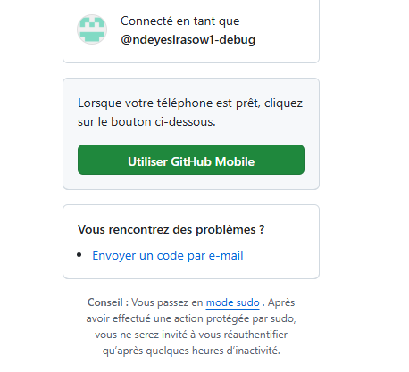

# Cira Express

Application e-commerce responsive installable sur Android.

## Démarrage

Depuis ce dossier, lancez :

```powershell
python -m http.server 8080
```

Puis ouvrez `http://localhost:8080` dans Chrome Android ou Chrome desktop.

## Installation sur Android

1. Ouvrez l’adresse hébergée sur HTTPS (ou `localhost` pour les tests).
2. Ouvrez le menu Chrome.
3. Sélectionnez « Ajouter à l’écran d’accueil ».

Le premier prototype comprend le catalogue, la recherche, les catégories, le panier, les commandes locales, le profil et un chat illustratif.

Pour publier sur GitHub Pages, téléversez `index.html`, `styles.css`, `app.js`, `manifest.webmanifest`, `sw.js`, `icon.svg` et `cira-express-logo.jpg` à la racine du dépôt.
